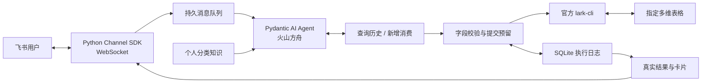

# 设计说明

## 核心结构

应用由一个本地进程、一个 Pydantic AI Agent、两个受控账本工具及一个 SQLite 执行日志组成。模型负责消费理解、分类、历史查询选择、交易数量判断和完成条件；程序负责校验字段、限制操作权限、保存提交状态以及基于真实回执生成卡片。

队列、字段检查、超时和卡片补发属于技术执行边界，不决定 Agent 应如何完成消费理解。工具没有业务步骤前置关系；查询历史是可选动作，Agent 可在已有依据充分时直接新增。

## 文件职责

| 文件 | 职责 |
|---|---|
| `src/bookkeeping/agent.py` | Agent、业务指引、知识上下文、两个工具和最终输出校验 |
| `src/bookkeeping/domain.py`、`knowledge.py` | 数据模型、金额与日期依据、完整分类路径和规则引用校验 |
| `src/bookkeeping/cli.py` | 固定命令、固定目标、字段转换、受控查询和回执解释 |
| `src/bookkeeping/journal.py` | 消息去重、原文位置预留、写入结果、恢复与待送达结果 |
| `src/bookkeeping/service.py` | 承载 Agent 运行、限制请求与时长、保存真实结果 |
| `src/bookkeeping/channel.py`、`cards.py` | SDK 长连接、跨事件循环交接、卡片进度和最终反馈 |
| `src/bookkeeping/audit.py`、`config.py` | 配置、凭证保护、详细日志及测试请求计数 |

## 分类知识

`knowledges/categories.json` 提供唯一合法路径集合。启动时检查它引用的表与配置一致，且 `knowledges/rules.json` 的兼容版本匹配；每条规则的分类路径也必须合法。个人知识库整体被 Git 忽略，代码不包含真实账本标识或个人分类规则副本。

Agent 根据用途、对象、规则条件、边界和必要的历史样本做语义判断。规则文件的草稿状态及冲突说明会一并提供，不把关键词匹配编排成分类程序。程序只验证路径、必要层级、分类依据存在以及规则引用合法；涉及多个规则时至少一条必须支持最终路径，允许同时引用解释用途优先关系的规则。

`knowledges/schema.json` 是本地私有表结构参考；实际启动以 CLI 读取的实时字段名称和类型为准。不会修改字段、增加选项或更改个人知识库。原始业务说明和包含个人规则的测试场景、模型回放样本也保存在 `knowledges/`，公开测试在临时目录生成独立的人工合成知识库。

## 字段与原文依据

每笔新增请求包含该笔的准确原文及出现序号。程序用原文定位消费范围，核对详情和金额依据在消息中的来源，验证 `Decimal` 金额为正且最多两位小数，再核对日期与分类。

数量与单价的计算允许加减乘除及括号，使用受限 AST 解释器和 `Decimal`，禁止名称、函数调用、属性、下标或幂运算。算式数字必须来自该笔完整原文，因此「两瓶」中的数量可以与金额证据片段中的单价共同构成依据。

只开放日期、一级分类、二级分类、三级分类、具体和金额六个字段。日期转为配置时区的零点 ISO 时间，单选分类转为 CLI 要求的字符串数组；不存在三级节点时不提交三级字段。

## 消息及写入状态

消息使用 `queued → running → done` 状态；消费提交使用 `submitted → success / failed / uncertain` 状态。

SDK 在后台事件循环调用处理器。处理器先把消息交给应用主循环，SQLite 保存原文、平台消息 ID 和会话 ID 后，才返回 SDK。Worker 串行运行任务，保持 CLI 表写入串行并避免跨线程使用 SQLite 连接。

写入前，数据库事务先预留原文范围并提交 `submitted` 状态；随后才启动 CLI。因此即使进程在 CLI 提交后、回执持久保存前中断，重启也能识别该笔为结果不确定。预留与表格新增无法形成跨系统原子事务，所以中断恢复优先避免重复提交，将这类消费交给人工核对。

同一消息的原文范围重叠时，返回之前提交的状态，不再次调用 CLI。不同原文出现位置允许记录相同商品和金额；不同消息 ID 也独立处理。模型仍负责识别同一笔消费的重复叙述，因为仅用内容和金额去重会误伤真实独立交易。

## 成功判定和反馈

官方 CLI 的 JSON 成功信封为 `ok: true`，新增回执的 `data.record_id_list` 必须包含唯一有效行 ID。满足这个契约即确认成功，不为核验新增而查询表格。

工具无法启动，以及飞书明确返回权限、参数等拒绝结果时，反馈未入账。写入已经启动但发生超时、未知异常、无法解析输出或缺少行 ID 时，反馈待核对。每笔消费的执行结果独立保存，后续模型请求失败或任务达到上限不会抹去之前的成功结果。

Agent 的结构化结束输出只有未提交消费及无消费状态，不包含可自行声明的成功列表。最终卡片的成功、失败和待核对记录全部来自 SQLite 中实际工具结果。未提交消费的原文也会核对，并阻止其原因擅自宣称记账成功。

进度卡片不会展示模型推理、工具参数、行 ID 或凭证。较长结果拆成多张卡片，保留所有消费。卡片失败时保留待送达状态，后续只补发结果，不重新记账。

## 请求限制和日志

单任务使用 Pydantic AI 的请求及工具调用上限，并用总运行超时保护本地进程。实际测试另在 HTTP 请求钩子中持久计数，客户端关闭隐式重试，禁止突破 10 次网络请求。

GLM-5.3-Flash 的官方模型说明列出了推理档位及默认行为，因此应用显式选择 `low`，并提供可配置的输出上限。首次测试出现思考内容耗尽输出额度后进行了这项调整。[官方模型说明](https://huggingface.co/zai-org/GLM-5.3-Flash)、[方舟 Chat API](https://docs.volcengine.com/docs/ark/chat-api?lang=zh)。

模型请求与响应、工具入参和回执、异常堆栈均保存在私有日志中。鉴权头不进入日志，原文中的已配置凭证和常见凭证格式进行脱敏。日志仍保留消费内容以支持排查，避免把个人数据当作普通项目源码发布。

## 依赖接口依据

- [Pydantic AI OpenAI 兼容接口](https://pydantic.dev/docs/ai/models/openai/)：使用 `OpenAIChatModel` 和自定义 `OpenAIProvider`。
- [Pydantic AI Agent](https://pydantic.dev/docs/ai/core-concepts/agent/)：使用 Agent 工具、依赖注入和请求上限。
- [官方 Python Channel SDK](https://github.com/larksuite/channel-sdk-python)：使用独立包 `lark-channel-sdk` 和 `lark_channel` 导入路径。
- [Channel SDK 接口参考](https://github.com/larksuite/channel-sdk-python/blob/main/docs/reference.md)：使用 WebSocket 接收消息，以及卡片发送与更新接口。
- 表格命令和 JSON 输出契约以当前安装的官方 `lark-cli` 帮助及其配套技能为准。本次在 `lark-cli 1.0.93` 上完成真实字段读取和写入预览。
