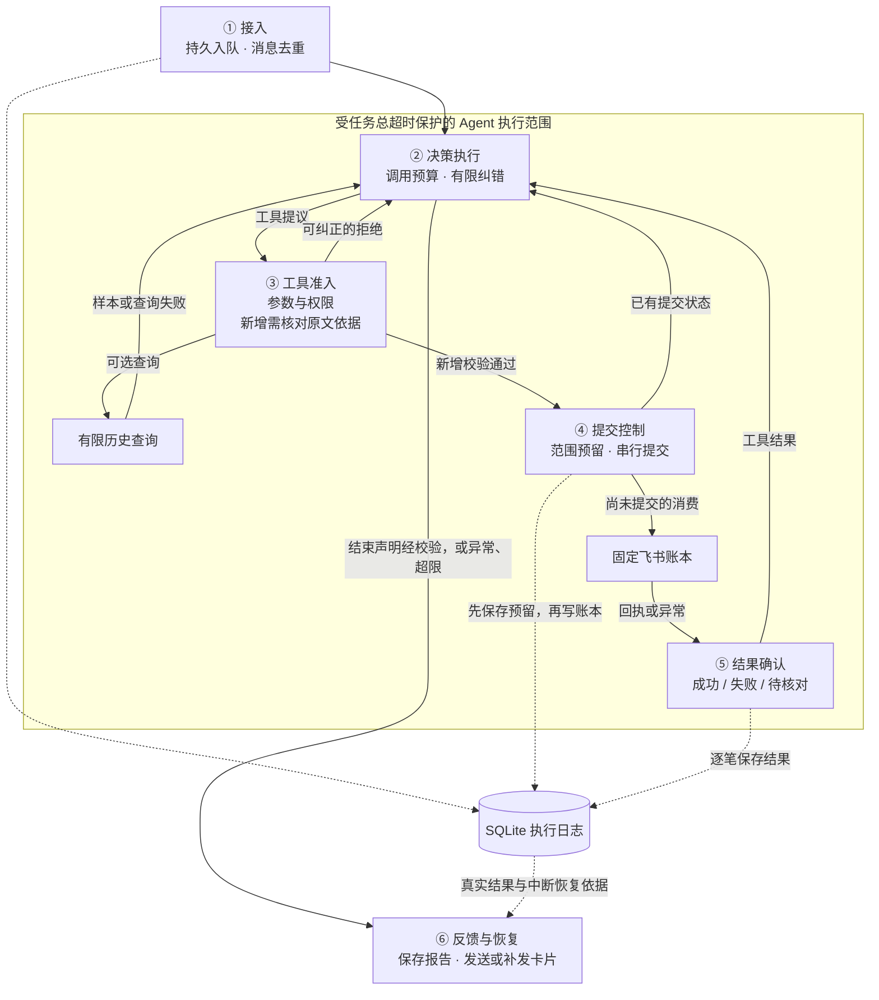

# 工程保障：原因、分层与流程

**目标：让可能出错的决策和执行，仍然受业务约束控制；发生故障时，保留已确认结果，明确尚未完成和需要核对的部分。**

## 为什么需要工程保障

| 本质原因 | 对记账的影响 |
|---|---|
| 决策不确定 | 模型可能误解消费、编造依据，参数完整也可能内容错误。 |
| 执行不可靠 | 模型请求、网络和工具可能失败或中断，决定执行不等于已经完成。 |
| 结果不一定可确认 | 写入可能成功但回执丢失，超时不能直接等同于未入账。 |
| 操作会改变真实状态 | 重试可能重复记账，多笔任务可能只完成一部分。 |
| 过程不保证收敛 | 模型可能反复调用合法工具，必须限制次数、时间和资源消耗。 |

## 本项目的六层保障

| 层次 | 核心保障 |
|---|---|
| ① 接入 | 消息先持久保存再确认接收，按平台消息 ID 去重，重启后继续处理未开始的消息。 |
| ② 决策执行 | 模型与工具调用限额、有限纠错、分层超时和任务上下文隔离，关闭模型客户端隐式重试。 |
| ③ 工具准入 | 只开放查询与新增，固定账本、命令和字段；校验参数结构，以及新增消费的原文、金额、日期和分类依据。 |
| ④ 提交控制 | 写入前持久保存原文范围、UUID 和消费快照；同一消息内重叠范围复用已有状态；进程互斥、任务与工具串行。 |
| ⑤ 结果确认 | 按真实回执区分状态，成功需有效行 ID；不确定提交等待 3 秒后按 UUID 查询一次，仅完整空结果允许补写一次；模型不能自行声明成功。 |
| ⑥ 反馈与恢复 | 保留部分成果，保存报告后发送卡片；失败只补发结果，中断提交标记待核对，不自动重写。 |

启动时检查知识库与真实表结构，运行中记录脱敏的请求、工具回执和异常，支持提前发现配置问题及事后定位故障。

## 各层的位置与联系

实线表示任务与结果流转，虚线表示持久状态关联；查询历史是可选分支，工具结果返回模型后可继续处理其他消费，结束或异常时统一保留执行日志中的真实结果。

**框架分工：** LangChain / LangGraph 提供 Agent 循环、运行状态、工具 Schema、结构化输出和中间件入口；调用预算、业务校验和串行锁由项目接入，去重与恢复由 SQLite 支撑，当前未启用 LangGraph 检查点恢复。

## 当前边界

- **语义判断仍有边界：** 是否实际消费、哪个数字是实付金额、分类规则是否适用等判断仍有模型参与，不能保证拦截全部幻觉。
- **同轮结束仍有一致性缺口：** 结束校验使用本轮写入前的状态，同轮新增与未入账声明可能矛盾，详见[既有边界](architecture.md#langchain-运行边界)。

实现细节见[设计说明](architecture.md)，验证范围见[测试与证据管理](test_report.md)。
